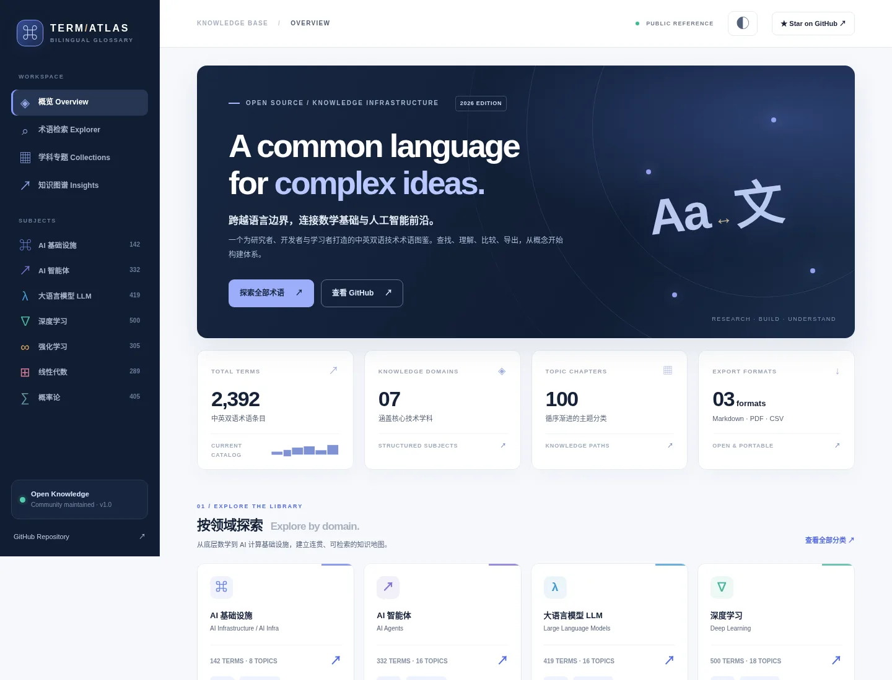

<div align="center">

# TERM/ATLAS

### Bilingual Technical Glossary · 中英双语专业术语库

**A structured reference for the language of mathematics, machine learning, and AI engineering.**

[中文说明](README.zh-CN.md) · [Browse the Explorer](https://1998x-stack.github.io/bilingual-technical-glossary/) · [Glossary Sources](glossaries/) · [Contribute](CONTRIBUTING.md)

</div>



---

## Overview

TERM/ATLAS is a Chinese–English terminology reference for students, researchers, practitioners and technical writers. The site combines **searchable terminology**, **topic-organized Markdown**, and **PDF handbooks**. All counts on the site are calculated from the actual structured dataset, not manually entered statistics.

### Current coverage

| Field | Chinese subject | Indexed terms | Topics | Markdown | PDF |
|---|---|---:|---:|---|---|
| High School Mathematics | 高中数学 | 351 | 16 | [Read](glossaries/high-school-mathematics.md) | [Download](pdf/high-school-mathematics.pdf) |
| AI Infrastructure / AI Infra | AI 基础设施 | 142 | 8 | [Read](glossaries/ai-infrastructure.md) | [Download](pdf/ai-infrastructure.pdf) |
| GPU Kernel Engineering | GPU Kernel / GPU 核函数 | 255 | 13 | [Read](glossaries/gpu-kernel.md) | [Download](pdf/gpu-kernel.pdf) |
| AI Agents | AI 智能体 | 332 | 16 | [Read](glossaries/ai-agents.md) | [Download](pdf/ai-agents.pdf) |
| Large Language Models | 大语言模型 LLM | 419 | 16 | [Read](glossaries/large-language-models.md) | [Download](pdf/large-language-models.pdf) |
| Deep Learning | 深度学习 | 500 | 18 | [Read](glossaries/deep-learning.md) | [Download](pdf/deep-learning.pdf) |
| Machine Learning | 机器学习 | 447 | 19 | [Read](glossaries/machine-learning.md) | [Download](pdf/machine-learning.pdf) |
| Reinforcement Learning | 强化学习 | 305 | 14 | [Read](glossaries/reinforcement-learning.md) | [Download](pdf/reinforcement-learning.pdf) |
| Calculus | 微积分 | 361 | 16 | [Read](glossaries/calculus.md) | [Download](pdf/calculus.pdf) |
| Linear Algebra | 线性代数 | 289 | 12 | [Read](glossaries/linear-algebra.md) | [Download](pdf/linear-algebra.pdf) |
| Compiler Principles | 编译原理 | 268 | 12 | [Read](glossaries/compiler-principles.md) | [Download](pdf/compiler-principles.pdf) |
| Probability Theory | 概率论 | 405 | 16 | [Read](glossaries/probability-theory.md) | [Download](pdf/probability-theory.pdf) |
| University Mathematics | 大学数学 | 627 | 17 | [Read](glossaries/university-mathematics.md) | [Download](pdf/university-mathematics.pdf) |
| Apache Kafka | Apache Kafka / 事件流平台 | 283 | 16 | [Read](glossaries/apache-kafka.md) | [Download](pdf/apache-kafka.pdf) |
| Data Structures | 数据结构 | 352 | 14 | [Read](glossaries/data-structures.md) | [Download](pdf/data-structures.pdf) |
| Linux | Linux 操作系统 | 394 | 16 | [Read](glossaries/linux.md) | [Download](pdf/linux.pdf) |
| Operating Systems | 操作系统 | 396 | 18 | [Read](glossaries/operating-systems.md) | [Download](pdf/operating-systems.pdf) |
| SQL Database | SQL 数据库 | 394 | 13 | [Read](glossaries/sql-database.md) | [Download](pdf/sql-database.pdf) |
| Python | Python 编程语言 | 429 | 16 | [Read](glossaries/python.md) | [Download](pdf/python.pdf) |
| Junior High School Mathematics | 初中数学 | 400 | 15 | [Read](glossaries/junior-high-mathematics.md) | [Download](pdf/junior-high-mathematics.pdf) |
| Parallel Computing | 并行计算 | 205 | 12 | [Read](glossaries/parallel-computing.md) | [Download](pdf/parallel-computing.pdf) |
| **Total** | **21 domains** | **7,554** | **313** | | |

### Additional standalone handbook (not yet indexed)

| Subject | Chinese subject | Glossary terms | Chapters | Markdown | PDF |
|---|---|---:|---:|---|---|
| Computer Organization & Architecture | 计算机组成原理 | 678 | 15 | [Read](glossaries/computer-organization.md) | [Download](pdf/computer-organization.pdf) |

> **Search status:** This publication includes 678 Chinese–English term pairs, 16 terminology distinctions and an abbreviation index. The original 39-page PDF and Markdown are available, but these entries are **not included** in the searchable index counts above until their definitions have been verified.

> **Parallel Computing:** The 205-term, 12-chapter independently authored handbook follows the knowledge architecture of Grama et al. (2003). Its original Markdown/PDF is preserved, and all 205 entries are now indexed for site search.

> **Data provenance.** The Kafka volume contributes 283 original, fully indexed terms in 16 chapters, with curated Markdown and searchable PDF editions.  The six existing subject PDFs are preserved as their full original, independently authored publications. The machine-readable index and Markdown were extracted and checked from these PDFs; extraction presently indexes 2,250 of the **2,298** terms reported in the six original covers (differences are mostly complex and wrapped PDF table rows). AI Infra adds 142 curated terms and a newly generated PDF. The GPU Kernel volume adds 255 original entries in 13 chapters; its searchable Markdown, PDF, and index entries are all included. Original PDFs are therefore the reference version when the index and print editions differ. The Compiler Principles glossary contributes 268 independently curated terms in 12 chapters and is available as Markdown, PDF, and searchable index entries. This explicit distinction prevents claiming that PDF extraction is lossless. The Machine Learning volume adds 447 independently authored entries across 19 topics, with matching Markdown and searchable PDF. Linux adds 394 fully indexed terms from its original Markdown, with 16 chapters and 18 concept comparisons; a searchable PDF is available.

## Newly indexed handbooks

Operating Systems (396), SQL Database (394), Python (429), Junior High School Mathematics (400) and Parallel Computing (205) are now included in the searchable index; authored Markdown and PDFs remain preserved.

## Features

- **Bilingual full-text search:** English, simplified Chinese, abbreviations, topic names, and definitions; multiple search words supported.
- **313 topic chapters:** thematic navigation from mathematical foundations to operational AI infrastructure.
- **Interactive coverage visualization:** bar chart generated directly from indexed content.
- **Practical reading path:** mathematical concepts → model training → LLM/Agent → AI systems.
- **Export:** subject-level Markdown and PDF; filtered search result as CSV; normalized JSON and CSV for programmatic reuse.
- **Accessible, responsive static site:** light/dark display, keyboard search (`Ctrl/⌘ + K` or `/`), no JavaScript dependencies or build framework required.
- **GitHub Pages ready:** prebuilt site in [`docs/`](docs/), plus optional Actions workflow deployment.

## Repository structure

```text
bilingual-technical-glossary/
├── data/
│   ├── terms.json                 # Canonical indexed terms
│   ├── terms.csv                  # Interoperable CSV export
│   └── ai-infrastructure.tsv     # Curated AI Infra source notes
├── sources/                       # Authored glossary print materials
├── glossaries/                    # 12 thematic Markdown glossaries
├── pdf/                           # 12 searchable PDF handbooks
├── site/                          # Website source: HTML, CSS, JS, icon
├── docs/                          # GitHub Pages static publish directory
│   ├── data/                      # Optimized JSON for frontend
│   ├── glossaries/                # Markdown downloads
│   └── pdf/                       # PDF downloads
├── scripts/
│   ├── build.py                   # Rebuild indexes, Markdown, site
│   └── verify.py                  # Structural checks
├── tests/                         # Regression tests
├── CONTRIBUTING.md
├── AGENTS.md
└── .github/workflows/
```

The Calculus volume adds 361 bilingual terms and a searchable PDF, preserving mathematical examples in the optional `notation` field. Its original manuscript is archived at [`sources/calculus.md`](sources/calculus.md).

## Use locally

```bash
git clone https://github.com/1998x-stack/bilingual-technical-glossary.git
cd bilingual-technical-glossary
python3 -m http.server 8000 --directory docs
# Open http://localhost:8000/
```

For Compiler Principles, edit the curated `data/compiler-principles.tsv` source; other indexed terms follow the existing `data/terms.json` conventions. Then run:

```bash
python3 -m pip install -r requirements.txt
python3 scripts/build.py
python3 scripts/verify.py
python3 -m unittest discover -s tests -v
```

The build script generates the AI Infra PDF when a suitable Chinese TTF font is installed. The GPU Kernel PDF is an independently authored original and is preserved, not regenerated from JSON. The six previously authored PDFs are intentionally **not** overwritten by this step. If no font is available, the script preserves any existing AI Infra PDF.

## Publish on GitHub Pages

1. Go to **Settings → Pages** on this repository.
2. Under **Build and deployment → Source**, choose **GitHub Actions**. The repository already contains `.github/workflows/pages.yml`, so do not generate another workflow.
3. Open **Actions → Publish TERM/ATLAS to GitHub Pages** and rerun the previously failed workflow (or use **Run workflow**), after enabling Pages.
4. Once deployment succeeds, open `https://1998x-stack.github.io/bilingual-technical-glossary/`.

The static site is fully committed in `docs/`. Initial Pages enablement requires a repository administrator; the workflow cannot enable Pages with its default token. See [deployment instructions](docs/PAGES_SETUP.md).

## Editorial principles

1. Preserve the English form used in primary research or official documentation.
2. Prefer common Chinese textbook/industry translations; record alternatives where necessary.
3. Explain terms in plain language without treating a particular implementation as a universal definition.
4. Distinguish homonyms across mathematics and software engineering (e.g., *rank*; *inference* vs *reasoning*).
5. Keep a verifiable source for proposed corrections; do not conflate models, products, frameworks and protocols.
6. Maintain all exported formats consistently; run validation before submitting PRs.

**License:** Licensing terms for source and reference content have not been selected; all rights remain with their respective authors until a license is explicitly published. Contributions should not include third-party copyrighted textbook passages without permission.
## University Mathematics / 大学数学

This original handbook contains 627 bilingual terms across 17 chapters plus three appendices. See the [editable HTML source](sources/university-mathematics.html), [Markdown](glossaries/university-mathematics.md), and [PDF](pdf/university-mathematics.pdf). It intentionally overlaps specialized Linear Algebra and Probability Theory collections; collection totals are not globally deduplicated.
